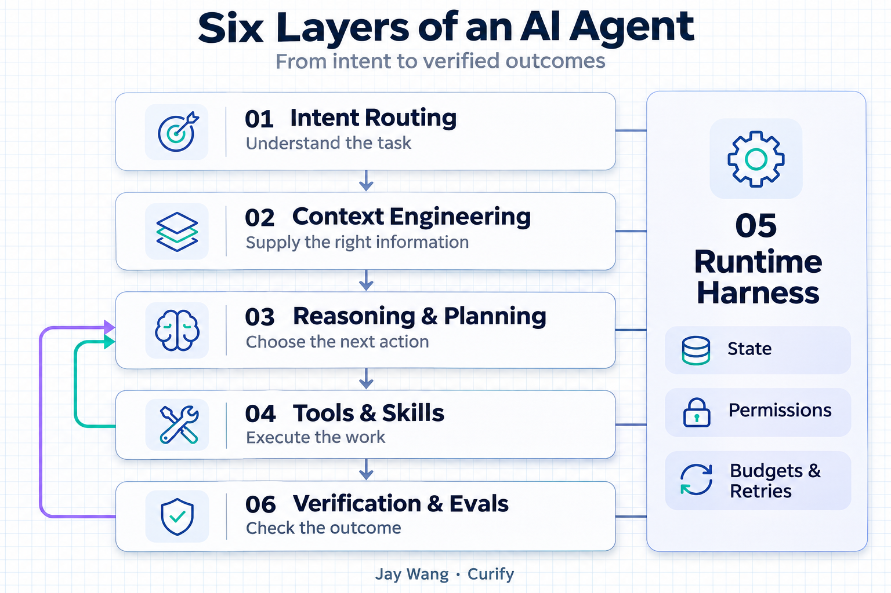

# Understanding the Six Layers of an AI Agent, Step by Step

Give a language model a few tools, and it can look surprisingly capable in a demo.

Real tasks expose the gaps. It misunderstands the request, uses outdated data, continues after a tool fails, and confidently announces that the report is ready.

In our agent development work, we use six layers to separate these responsibilities: intent routing, context engineering, reasoning and planning, tools and skills, the runtime harness, and verification and evaluation.

This is an engineering framework, not a universal standard. Six layers do not require six models, six agents, or six services.

Let’s follow one request: **“Find out why sales fell last month and prepare a report.”**

## 1. Intent routing: establish the task

“Look at sales” could mean retrieving a number, comparing channels, or producing a downloadable report. Each requires a different path.

The intent router identifies the goal and checks whether the system has the capability to address it.

Which business are we analysing? What does “last month” mean for the reporting period and time zone? Who will read the report? Is the data available?

Ask when an essential detail is missing. A system that can analyse uploaded files should not behave as though it has access to the company database. A clear, routine request can go directly to a predefined workflow.

A useful outcome is a bounded task: compare these two monthly files, break down changes by channel, and produce an internal report with charts.

## 2. Context engineering: supply what this step needs

Understanding the request does not give the model the information required to fulfil it.

Context engineering selects the instructions, definitions, data, previous results, and user updates relevant to the next model call.

Does revenue include refunds? Are both files in the same currency? Did the user ask to exclude newly opened stores? An analysis can be mathematically correct and still use the wrong definition.

An important distinction: **what the system stores is not the same as what the model needs to see now.**

The task history may live in a database, and the full dataset in a file. For one decision, the model may need only the schema, a summary, and a few anomalous records. Tools can retrieve more when necessary.

If the user adds “only include established stores,” that constraint must reach the subsequent analysis. A long conversation history alone does not ensure the right information is selected.

## 3. Reasoning and planning: act, observe, and revise

The system can now organise the work: inspect the data, reconcile definitions, compare channels, investigate anomalies, build charts, and write the report.

Producing that plan is only part of the job.

Suppose inspection reveals that last month’s file is missing a week. The next action should change: request the missing data or narrow the analysis. Continuing to explain the decline would turn a data-quality problem into a misleading business narrative.

The loop is: **choose an action, execute it, observe the result, and revise the plan.**

Not every step needs model-driven planning. A recurring report may use a fixed workflow, with dynamic decisions only where the result calls for a different path. [Anthropic’s discussion of workflows and agents](https://www.anthropic.com/research/building-effective-agents) offers a useful distinction here.

## 4. Tools and skills: perform the work

“I will calculate it” is not a calculation.

Tools provide executable capabilities: querying data, running computations, creating charts, and exporting files.

Their contracts matter. A query needs a defined date range. A calculation should return its result and relevant assumptions. An export should return a file reference and a clear status. Errors must be distinguishable from success.

A skill can package a reusable procedure—such as checking a sales dataset and preparing a monthly analysis—which may call several tools.

Tools and skills need not be mutually exclusive categories. The practical question is whether the caller understands what a capability does, what it requires, and how to interpret its result. A connection protocol such as MCP does not, by itself, make the underlying operation reliable.

## 5. The runtime harness: control execution

The first four layers can produce a convincing demo. Longer tasks reveal operational questions.

What happens after a timeout? Can the task resume after a restart? What is the budget? Which actions require approval?

The harness is the runtime that hosts execution and manages state, permissions, budgets, retries, and logs.

Planning chooses what to do next. The harness checks whether that action is allowed, arranges execution, and records what happened.

Consider an export request that times out. A timeout does not establish that the export failed. Retrying blindly could create duplicate files. The system needs to reconcile the existing result or use a mechanism that recognises repeated requests.

Likewise, permission to prepare a report does not grant permission to email it to every customer. Enforce that boundary in software rather than relying on a cautionary prompt.

This also clarifies the difference from context engineering: the harness persists progress; context engineering selects which parts of that progress the next model call needs.

## 6. Verification and evaluation: establish whether it worked

“Done” is a report from the agent. The system still needs evidence.

For the sales report, check several dimensions:

- **Data and calculations:** complete dates, reconciled totals, consistent treatment of refunds.
- **Deliverables:** a readable file, actual charts, and references to the correct dataset.
- **Conclusions:** no unsupported leap from correlation to causation, with missing evidence acknowledged.
- **Execution:** appropriate access, no unintended duplicate actions, and acceptable time and cost.

Use programmatic checks where the answer can be established precisely. For judgment-based criteria, use an explicit rubric with model-assisted or human review. The reviewer needs validation too.

Verification concerns this particular task. Evaluation examines performance across a collection of tasks. Keep cases involving missing data, changed requirements, and tool failures, then rerun them when the system changes.

Checks belong at intermediate points as well as at the end. Catching incomplete data early is more useful than rejecting a polished report built on it. For further reading, see [this guide to agent evaluations](https://www.anthropic.com/research/demystifying-evals-for-ai-agents).

## How the layers work together

| Layer | Main question | A typical failure without it |
|---|---|---|
| Intent routing | What is the task, and can we handle it? | Completing the wrong task |
| Context engineering | What must this step know? | Losing constraints or mixing definitions |
| Reasoning and planning | What should happen next? | Following a plan despite contradictory evidence |
| Tools and skills | How does the work actually execute? | Describing actions without producing results |
| Runtime harness | How is execution controlled and recorded? | Duplicate work, lost progress, endless retries |
| Verification and evaluation | What demonstrates success or improvement? | Accepting a confident completion message |

These are not six stations on a one-way conveyor belt. Tool results update state and context. A failed check may cause replanning, a pause, or a request for more information. The harness manages execution throughout.

Start with a narrow task: read one file, calculate one metric, and export one result. Then introduce incomplete inputs, a failed operation, and a changed requirement. Decide how the system should respond and how you will verify it.

Each layer now addresses a concrete problem. When something fails, you have a way to locate the issue instead of attributing every failure to the model’s intelligence.

If you are moving from data science or software engineering into AI, or building an agent of your own, [find me on MentorCruise](https://mentorcruise.com/mentor/jaywang/) to discuss your learning plan, architecture, and project work.

You can also explore [Curify](https://curify-ai.com/) to see our products and application work in visual creation and design workflows.
