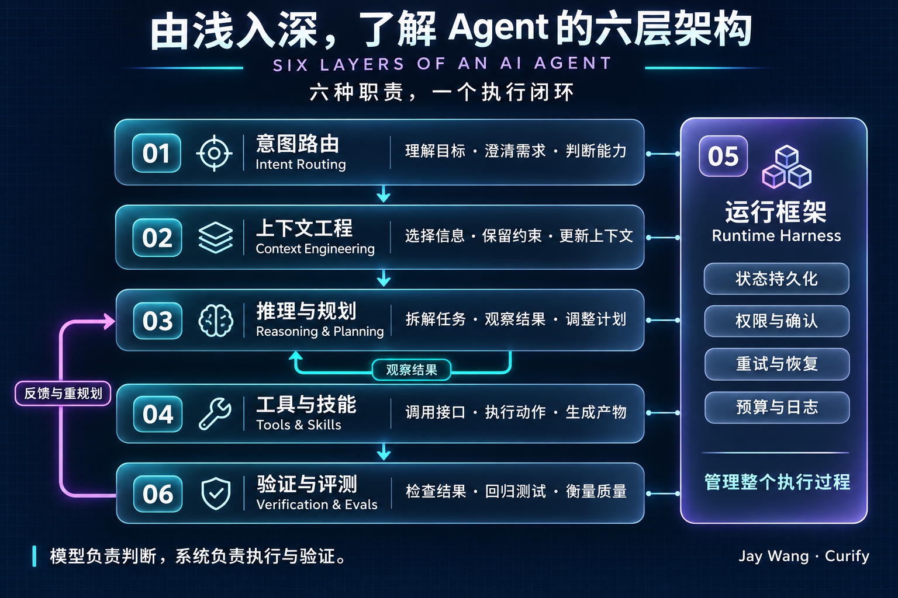

# 由浅入深，了解 Agent 的六层架构

给大模型接几个工具，它就能替你把事情做完了吗？

第一次演示时，往往看起来可以。真正接到用户的任务后，问题才逐个出现：它理解错了需求，拿了过期的数据，工具失败后继续往下走，最后还很自信地告诉你“报告已完成”。

我们在开发 Agent 时，用六个层次来拆这些问题：意图路由、上下文工程、推理与规划、工具与技能、运行框架，以及验证与评测。

这是一种工程上的拆解方式，并非所有 Agent 都必须遵循的统一标准。六层也不等于六个模型、六个 Agent，或者六个独立服务。它们划分的是责任。

用一个例子来讲：用户说，**“帮我看看上个月销售为什么下降，做一份报告。”**

## 第一层：意图路由——先弄清楚要做什么

“看看销售”可能是查一个数字，也可能是比较渠道表现，还可能要求生成一份可下载的文件。任务不同，需要走的处理路径也不同。

意图路由（Intent Router）负责识别目标，并判断系统有没有相应能力。

在这个例子里，它至少要弄清楚：用户要分析哪个业务？“上个月”按哪个时区和统计口径？报告给谁看？有数据吗？

如果缺少关键条件，就先问。如果系统只能分析上传的表格，就不能假装自己已经连接了公司的数据库。对于清晰、固定的任务，路由可以直接调用预设流程，不必让模型临场规划。

这一层最有价值的输出，是一个明确的任务边界。例如：“使用这两份月度销售表，比较渠道变化，生成一份带图表的内部分析稿。”

## 第二层：上下文工程——让它看到当前需要的信息

任务明确了，不代表模型已经具备完成任务的信息。

上下文工程（Context Engineering）决定每一步把什么交给模型：任务约束、指标定义、相关数据、已经完成的步骤，以及用户刚刚补充的要求。

例如，“销售额”是否扣除了退款？两个文件的币种是否一致？用户是否要求排除新开门店？这些信息缺一项，都可能得到一份算得很认真、但口径错误的报告。

这里要区分两个概念：**系统保存的信息，不等于本次模型调用需要看到的信息。**

数据库可以保存整段任务历史，文件系统可以保存完整数据；模型这一轮可能只需要字段说明、汇总结果和一段异常样本。需要时再通过工具读取原始内容。

用户补充“只看老门店”之后，也要让这个约束进入后续步骤，而不是继续沿用上一轮的分析范围。

## 第三层：推理与规划——做一步，看结果，再决定下一步

有了目标和信息，接下来是组织行动。

推理与规划（Reasoning & Planning）可以先形成一个方案：检查数据、统一口径、按渠道分解变化、检查异常、生成图表、撰写报告。

但写出一份计划，只完成了这层的一部分。

假设数据检查发现，上个月少了一周的记录。此时应该先暂停比较，补充数据或缩小结论范围。继续按原计划写“销售下滑原因”，只会把数据缺失包装成业务洞察。

所以这里需要一个循环：**决定下一步 → 调用工具 → 观察结果 → 调整计划。**

不是每个任务都值得动态规划。步骤固定的报表可以用确定的流程；只有遇到需要根据结果选择路径的部分，才让模型参与决策。这种 workflow 与 agent 的区分，也见于 [Anthropic 的工程说明](https://www.anthropic.com/research/building-effective-agents)。

## 第四层：工具与技能——把动作变成真实执行

模型说“我来计算”，不等于计算已经发生。

工具层（Tool / Skill Layer）提供真正可以执行的能力：查询数据、运行计算、生成图表、导出文件。

一个工具需要清楚说明输入、输出和失败方式。比如，读取销售数据需要日期范围；计算工具返回数值和使用的口径；导出工具返回文件位置和状态。失败也应该明确返回，不能只给一句看起来像成功的自然语言。

技能则可以封装一套可复用的操作方法，例如“检查销售表并生成月度分析”，内部可能使用多个工具。

工具和技能不是天然互斥的分类，重点是调用方能否知道它们能做什么、需要什么，以及结果是否可用。接上 MCP 等协议，也不意味着接口背后的能力已经可靠。

## 第五层：运行框架——让整个过程跑得住、停得下

前四层已经能跑出一个 demo。任务一长，运行问题就会暴露出来。

工具超时了怎么办？服务重启后能不能接着做？最多花多少时间和费用？哪些动作必须由用户确认？

这些通常由 Harness，也就是 Agent 的运行框架来管理。它承载执行循环，并管理状态、权限、预算、重试和日志。

可以把第三层和第五层的分工理解为：规划负责决定下一步做什么；运行框架负责检查能否执行、安排执行，并把结果和状态保存下来。

例如，报告导出请求超时了。超时并不能证明导出失败。直接重试可能生成重复文件，运行框架需要先核对已有结果，或使用能够识别重复请求的机制。

同样，“请生成报告”也不等于“可以发给所有客户”。权限要由程序限制，不能只指望 prompt 写着“请谨慎”。

这里也能解释第二层与第五层的区别：运行框架保存“已经处理到哪里”；上下文工程选择其中哪些信息，需要给下一次模型调用看。

## 第六层：验证与评测——凭什么判断它做对了

最后，Agent 说“完成”只是一个汇报。系统还要检查实际结果。

在这份销售报告里，可以分开验证：

- **数据与计算**：日期完整吗？合计能否对上？退款口径是否一致？
- **交付物**：报告文件能否打开？图表是否存在？引用的是不是本次数据？
- **结论质量**：是否把“同时发生”写成了“导致”？证据不足的地方有没有交代？
- **执行过程**：是否越权访问数据？是否重复执行？耗时和费用是否在范围内？

能精确检查的内容，优先用程序检查。需要判断的内容，可以用明确的评分标准结合模型或人工复核。模型评审本身也需要校验。

**验证**关注眼前这次任务；**评测**关注一组任务上的表现。把正常数据、缺失数据、用户中途改要求、工具超时等场景保存下来，修改模型或流程后重新运行，才知道新版本有没有修好一个问题、又引入另一个问题。

验证不必等到最后。数据不完整时，第二步就应该发现；只有需要的中间检查也通过，最终报告才有可信的基础。[Agent 评测的结构与方法](https://www.anthropic.com/research/demystifying-evals-for-ai-agents)可以作为延伸阅读。

## 六层放在一起，怎么用？

| 层次 | 它负责回答的问题 | 缺了以后常见的表现 |
|---|---|---|
| 意图路由 | 用户究竟要什么？系统能做吗？ | 很认真地完成了错误任务 |
| 上下文工程 | 这一步需要知道什么？ | 忘记约束、混用版本或口径 |
| 推理与规划 | 根据当前结果，下一步做什么？ | 写完计划，一条路走到底 |
| 工具与技能 | 怎样真正执行？ | 只描述动作，没有实际产物 |
| 运行框架 | 怎样保存进度、控制执行？ | 重复操作、失去状态、无限重试 |
| 验证与评测 | 怎样证明结果可用、版本有进步？ | 只凭一句“完成”验收 |

它们并不是从第一层顺着走到第六层就结束的流水线。工具结果会更新状态和上下文，验证失败可能触发重新规划，也可能要求暂停或请用户补充信息。运行框架始终管理这个过程。

刚开始做项目，可以只实现一个很窄的任务：读一份表、算一个指标、导出一个文件。然后逐项追问：输入不完整怎么办？计算失败怎么办？用户改要求怎么办？怎样检查产物？

这样搭出来的六层，每一层都有具体要解决的问题。下一次遇到 Agent 出错，也更容易判断该改的是任务理解、工具接口，还是执行与验证，而不是把所有问题都归结为“模型不够聪明”。

如果你正在从 Data Science 或软件工程转向 AI，或者正在做自己的 Agent 项目，欢迎在 [MentorCruise 找我](https://mentorcruise.com/mentor/jaywang/)，一起讨论学习路线、架构和项目实践。

也欢迎访问 [Curify](https://curify-ai.com/)，了解我们在视觉创作与设计工作流上的产品和应用探索。
